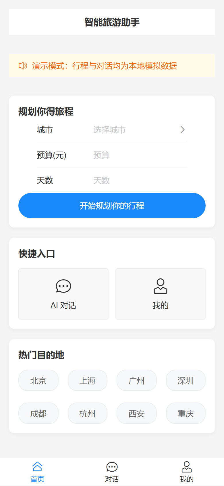
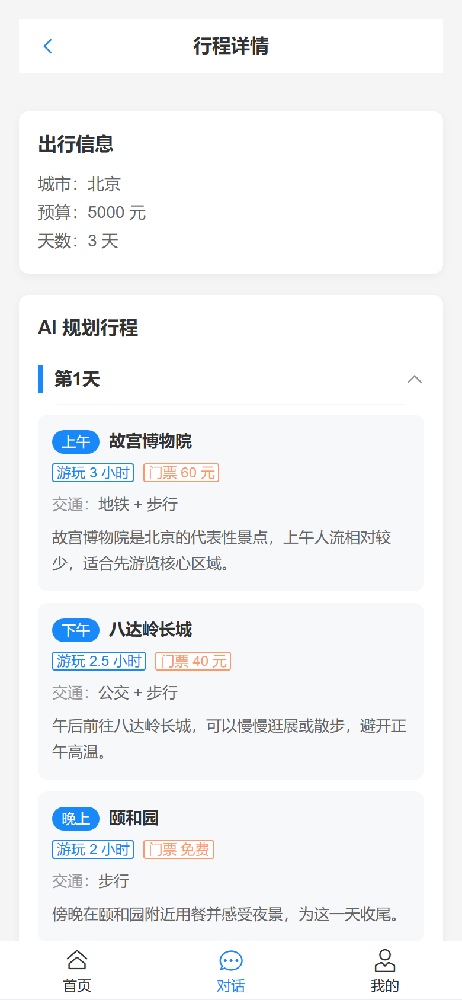
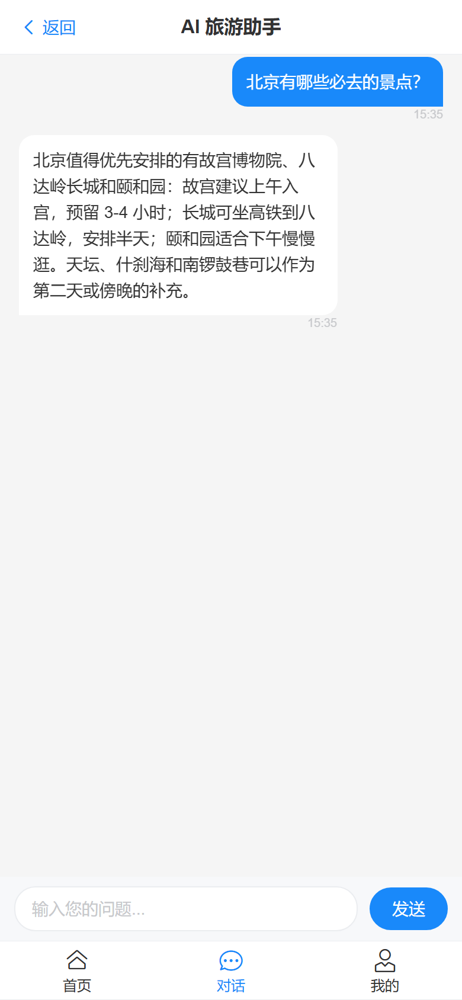
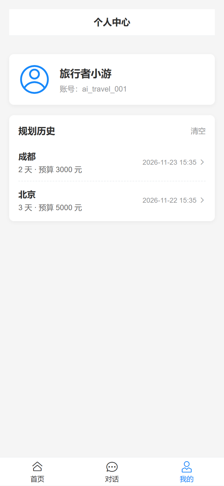
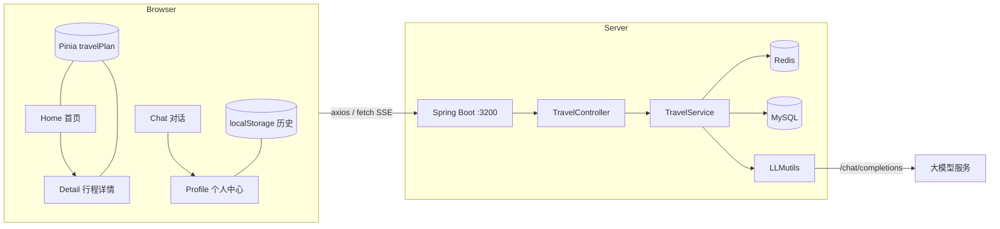

# AI 智能旅游助手

基于 **Vue 3 + Spring Boot** 的前后端分离移动端 H5 应用：输入城市、预算和天数，由大模型生成结构化行程；支持 SSE 流式 AI 对话、本地历史记录与移动端交互。


**在线 Demo**：<https://yuqi2325.github.io/ai-traval/>（纯前端演示模式，无需后端与 API Key）

> 仓库说明：本仓库只包含前端与演示数据。配套的 Spring Boot 后端仅用于本地开发，未提交到仓库（避免密钥泄露），因此线上 Demo 使用 `VITE_DEMO_MODE` 的本地模拟数据。

## 项目截图

| 首页 | 行程详情 |
| --- | --- |
|  |  |

| AI 流式对话 | 个人中心 |
| --- | --- |
|  |  |

## 功能

- **AI 行程规划**：按城市 / 预算 / 天数生成每日上午、下午、晚上三段行程，并给出预算分配、温馨提示和注意事项。
- **AI 流式对话**：后端通过 `SseEmitter` 逐片推送，前端按行解析 SSE 数据并渲染打字机效果，包含思考中状态、发送防抖和自动滚动。
- **行程历史**：结果连同查询条件存入 `localStorage`，相同条件自动覆盖、最多保留 30 条，从历史进入时直接展示缓存结果。
- **移动端体验**：Vant 4 组件、Tabbar 布局、悬浮行程入口、页面切换后状态不丢。
- **演示模式**：`VITE_DEMO_MODE=true` 时不依赖后端，使用 [src/mock](src/mock/index.js) 的本地数据，可直接部署到 GitHub Pages。

## 技术栈

| 层 | 技术 |
| --- | --- |
| 前端 | Vue 3（`<script setup>`）、Vite、Vue Router、Pinia、Vant 4、Axios |
| 后端 | Spring Boot 3.2、Spring Validation、Spring Data JPA、SseEmitter、OkHttp |
| 数据 | MySQL（规划记录 / 对话消息）、Redis（行程缓存 / 多轮上下文 / 限流） |
| 大模型 | SiliconFlow OpenAI 兼容接口（模型可配置） |
| 测试 | Vitest + @vue/test-utils + jsdom |

## 架构



前端分层：视图（`views`）→ 状态（`stores`）→ 接口（`apis`）→ 网络（`util/http.js`）→ 存储（`util/history.js`），页面本身不直接发请求。

## 核心实现

**1. SSE 流式渲染与粘包处理**

网络分片不保证按行到达，前端先累积到 `buffer`，再按 `\n` 切分，最后一段不完整的数据留在缓冲区等待下一个分片（[Chat.vue](src/views/layout/compontent/Chat.vue)）。同时兼容 `data:` 前缀与 `[DONE]` 结束标记。

**2. 请求竞态控制**

行程数据放在 Pinia 中，每次请求携带自增 `requestId`，响应回来时比对序号，旧条件下的迟到的响应不会覆盖新结果（[travelPlan.js](src/stores/travelPlan.js)）。

**3. 缓存与降级链路**

后端推荐流程：Redis 缓存（24h）→ MySQL 最近 7 天同条件成功记录兜底 → 调用大模型。Redis 不可用时所有操作自动降级，接口仍可用，只是没有缓存、上下文和限流效果。

**4. 对话上下文与限流**

Redis List 保存最近 10 条对话（5 轮），过期后用 MySQL 最近 20 条重建；按客户端每分钟最多 10 次对话请求，防止刷接口消耗 token。

**5. 演示模式**

网络层与接口层同时判断 `VITE_DEMO_MODE`：行程返回本地生成的模拟数据，对话按同样的 SSE 格式分片推送，因此部署到静态托管后仍能完整体验交互。

## 目录结构

```text
.
├── src/                        # 前端
│   ├── views/layout/           # 布局、Tabbar、四个页面
│   ├── stores/travelPlan.js    # 行程状态、请求序号、历史复用
│   ├── apis/traval.js          # 接口声明（含演示模式分支）
│   ├── util/http.js            # axios 封装 + fetch 流式读取
│   ├── util/history.js         # localStorage 历史记录
│   ├── mock/index.js           # 演示模式模拟数据
│   └── __tests__/              # store 与工具函数单测
├── docs/screenshots/           # README 截图
└── .github/workflows/          # GitHub Pages 自动部署
```

## 本地运行

### 前端

```bash
npm install
npm run dev          # http://localhost:5173，需要后端
npm run dev:demo     # 演示模式，无需后端
npm run test:unit    # 单元测试
npm run build        # 生产构建
```

### 本地完整版（前端 + 后端）

后端工程只保留在本地（未提交到仓库）。联调时先启动本地的 Spring Boot（默认 `http://127.0.0.1:3200`），再运行前端：

```bash
npm install
npm run dev          # http://localhost:5173
```

前端默认用相对路径 `/api` 请求，开发环境由 Vite 代理转发到 `http://127.0.0.1:3200`；如需连接其他地址，复制 [.env.example](.env.example) 为 `.env.local` 并设置 `VITE_API_BASE_URL`。

### 环境变量

| 变量 | 说明 |
| --- | --- |
| `VITE_API_BASE_URL` | 后端地址；留空时走同源 `/api`，开发环境由 Vite 代理到 `127.0.0.1:3200` |
| `VITE_DEMO_MODE` | `true` 时使用本地模拟数据，不请求后端 |

演示模式构建使用 [.env.demo](.env.demo)，已在 npm scripts 中配置好。

## 部署到 GitHub Pages

1. 将仓库推送到 GitHub，默认分支为 `main`；
2. 仓库 **Settings → Pages → Source** 选择 **GitHub Actions**；
3. 推送到 `main` 后，[deploy-demo.yml](.github/workflows/deploy-demo.yml) 会自动以演示模式构建并发布；
4. 把本 README 顶部的 Demo 地址替换成实际的 `https://<用户名>.github.io/<仓库名>/`。

演示构建使用 hash 路由，刷新页面不会 404；生产构建仍是 history 路由。

## 已知限制

- 本地完整版没有用户体系，个人中心信息为前端写死；
- 线上演示的数据为本地模拟，仅用于展示交互，不代表真实大模型效果；
- 测试覆盖状态层与工具函数，尚未覆盖组件与接口。

## License

[MIT](LICENSE)
